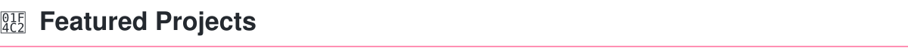

  

[Español](README.md) · **English**

# Hi, I'm Yaskelly Yedra

**Computer Science professor and researcher · Universidad del Zulia (LUZ), Venezuela**

I connect software engineering, artificial intelligence, data science and cloud with teaching and research. Through YaskCode, I design learning experiences where students build projects, document decisions and assess the quality of both the engineering process and its outcomes.

<table align="center">
  <tr>
    <th align="center" width="50%"><a href="https://yaskelly.github.io/yaskellyyedra/">Personal academic website</a></th>
    <th align="center" width="50%"><a href="https://yaskelly.github.io/">YaskCode Campus</a></th>
  </tr>
  <tr>
    <td align="center">Academic background, teaching, research and service.</td>
    <td align="center">Learning ecosystem, projects and open resources.</td>
  </tr>
</table>

  
  
  
  
  

  
  
  
  

## Featured projects and resources

### YaskCode Campus
A digital campus inspired by university spaces, connecting education, research, projects and technology communities.
- **My role:** creator and educational experience designer.
- **Status:** published and evolving.
- **Technologies:** Astro, TypeScript, HTML, CSS and GitHub Pages.
- **Evidence:** [visit the Campus](https://yaskelly.github.io/) · [source code and documentation](https://github.com/yaskelly/yaskelly.github.io).

### Research Project Resources — LUZ
An institutional repository providing regulations, forms and guidance for research projects in the Computer Science Department.
- **My role:** academic coordination and student guidance as Research Work Coordinator.
- **Status:** public resource available for consultation.
- **Evidence:** [repository and usage guide](https://github.com/LUZ-Computing-Research/recursos-proyectos).

### Software Engineering and Databases
A four-week teaching program covering quality, design and the development of an intelligent platform.
- **My role:** course design and guidance of master's student projects.
- **Status:** course plan published; this resource alone does not represent a completed application.
- **Program tools:** GitHub, Mermaid, modeling and software quality assessment.
- **Evidence:** [weekly program](https://github.com/YaskCode/ing-sofware-y-base-datos/tree/main/docs/programa).

[Explore more repositories](https://github.com/yaskelly?tab=repositories)

## The YaskCode ecosystem

Each space supports a different part of learning through practice.

| Space | Purpose |
| --- | --- |
| [YaskCode Academy](https://github.com/YaskCode) | Education, learning paths and resources for learning by building. |
| [YaskCode Laboratory](https://github.com/YaskCode-laboratory) | Student projects, documentation and engineering practices. |
| [YaskCode Research](https://github.com/YaskCode-research) | Research and academic mentoring. |
| [YaskCode Community](https://github.com/YaskCode-community) | Events, collaboration and shared learning. |
| [LUZ Computing Research](https://github.com/LUZ-Computing-Research) | Institutional research resources and coordination in Computer Science. |

The [Campus](https://yaskelly.github.io/) also points to **YaskCode Build**, with projects under development, and **Smart Learning**, announced as an upcoming space.

## Teaching, research and community

- **Teaching:** software engineering, AI, data science, databases, architecture and cloud. [Explore a teaching program](https://github.com/YaskCode/ing-sofware-y-base-datos/tree/main/docs/programa).
- **Research:** connecting software engineering and digital learning ecosystems with academic mentoring. [Google Scholar publications](https://scholar.google.com/citations?user=zySpQB0AAAAJ) · [ORCID](https://orcid.org/0009-0004-4290-120X).
- **Community:** GDG Caracas organizer, Women Techmakers ambassador and WiDS ambassador. [GDG Caracas activities](https://gdg.community.dev/gdg-caracas/) · [WiDS profile](https://community.widsworldwide.org/members/41641225).

## Focus areas and technologies

My focus areas include **AI agents and RAG**, **data science**, **cloud**, and **Computer Science education and research**.

- **AI and data:** Python, Gemini, LangChain, ChromaDB, FAISS, Pandas and scikit-learn.
- **Cloud:** Google Cloud and Vertex AI.
- **Engineering and collaboration:** Git, GitHub Projects, GitHub Actions, Mermaid, GitHub Copilot and Docker.
- **Campus web development:** Astro, TypeScript, HTML and CSS.

Each repository documents its specific technologies and usage instructions.

## Videos and audiovisual resources

Classes, talks and workshops on [YouTube — YaskCode](https://www.youtube.com/@yaskcode).

Selection retrieved from the channel's public feed. Each video links to its original publication.

<!-- YOUTUBE:START -->

 <a href="https://www.youtube.com/watch?v=jihUXbHcd4c">Validación y Pruebas de Software | Unitarias, Integración, Caja Negra y Caja Blanca</a> Published: 2026-09-04

 <a href="https://www.youtube.com/watch?v=8mfNY1ljvGA">SI Erick</a> Published: 2026-09-03

 <a href="https://www.youtube.com/watch?v=hT-6WChdBHI">Interoperabilidad y communicación entre agentes inteligentes</a> Published: 2026-08-30

<!-- YOUTUBE:END -->

## GitHub activity

**Snapshots regenerated on October 10, 2026; these are not live counters.** Update scripts are included in this repository. Statistics regeneration and bilingual YouTube updates were verified on October 10, 2026. Scheduled execution should be checked after the workflows are integrated into the default branch.

  
  
  

View saved contribution calendar

[View current GitHub activity](https://github.com/yaskelly) · [Automation history](https://github.com/yaskelly/yaskelly/actions)

## Contact and academic background

[Full academic background](https://yaskelly.github.io/yaskellyyedra/) · [LinkedIn](https://www.linkedin.com/in/yaskelly/) · [Academic contact: yyedra@fec.luz.edu.ve](mailto:yyedra@fec.luz.edu.ve)

> Learning Software Engineering by doing Software Engineering.

