

  

[Español](README.md) · **English**

# Hi, I'm Yaskelly Yedra

**Computer Science professor and researcher · Universidad del Zulia (LUZ), Venezuela**

I bring software engineering, artificial intelligence, data science and cloud computing into teaching and research. Through YaskCode, I design learning experiences where students build projects, document decisions and assess the quality of both the engineering process and its outcomes.

<table align="center">
  <tr>
    <th align="center" width="50%"><a href="https://yaskelly.github.io/yaskellyyedra/">Personal academic website</a></th>
    <th align="center" width="50%"><a href="https://yaskelly.github.io/">YaskCode Campus</a></th>
  </tr>
  <tr>
    <td align="center">Academic background, teaching, research and service.</td>
    <td align="center">Learning ecosystem, projects and open resources.</td>
  </tr>
</table>

  
  
  
  
  
  
  

## Teaching, research and community

- **Teaching:** software engineering, AI, data science, databases, architecture and cloud. [Explore a teaching program](https://github.com/YaskCode/ing-sofware-y-base-datos/tree/main/docs/programa).
- **Research:** connecting software engineering and digital learning ecosystems with academic mentoring. [Google Scholar publications](https://scholar.google.com/citations?user=zySpQB0AAAAJ) · [ORCID](https://orcid.org/0009-0004-4290-120X).
- **Community:** GDG Caracas organizer, Women Techmakers ambassador and WiDS ambassador. [GDG Caracas activities](https://gdg.community.dev/gdg-caracas/) · [WiDS profile](https://community.widsworldwide.org/members/41641225).

  <a href="https://github.com/YaskCode" title="Learning paths and resources for learning by building.">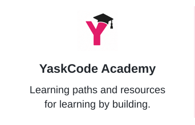</a>
  <a href="https://github.com/YaskCode-laboratory" title="Student projects and engineering practices.">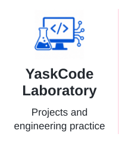</a>
  <a href="https://github.com/YaskCode-research" title="Research and academic mentoring.">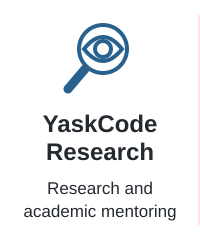</a>
  <a href="https://github.com/YaskCode-community" title="Events, collaboration and shared learning.">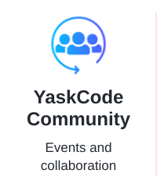</a>
  <a href="https://github.com/YaskCode-build" title="Prototypes and innovation. Under development.">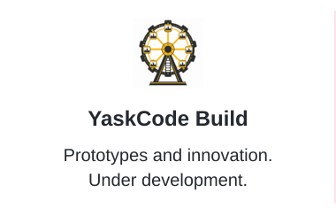</a>
  <a href="https://github.com/YaskCode-smart-learning" title="Learning ecosystems. Coming soon.">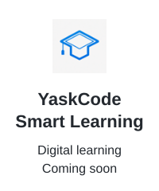</a>

Explore the purpose of each organization

- [**YaskCode Academy**](https://github.com/YaskCode): Learning paths and resources for learning by building.
- [**YaskCode Laboratory**](https://github.com/YaskCode-laboratory): Student projects and engineering practices.
- [**YaskCode Research**](https://github.com/YaskCode-research): Research and academic mentoring.
- [**YaskCode Community**](https://github.com/YaskCode-community): Events, collaboration and shared learning.
- [**YaskCode Build**](https://github.com/YaskCode-build): Prototypes and innovation. Under development.
- [**Smart Learning**](https://github.com/YaskCode-smart-learning): Learning ecosystems. Coming soon.

  <a href="https://github.com/LUZ-Computing-Research" title="Institutional research resources and coordination.">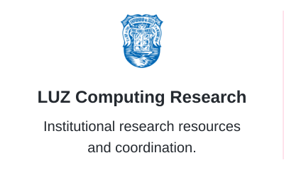</a>
  <a href="https://github.com/maestriaentic-luz" title="Graduate education, projects and academic guidance.">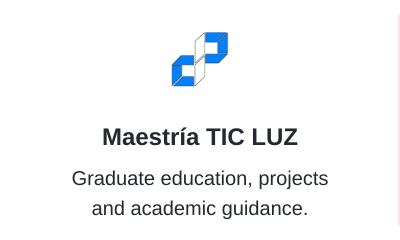</a>
  <a href="https://gdg.community.dev/gdg-caracas/" title="Developer community, talks and workshops.">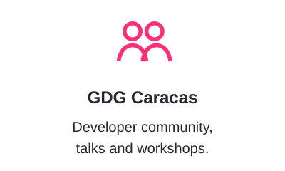</a>

Read about these spaces

- [**LUZ Computing Research**](https://github.com/LUZ-Computing-Research): Institutional research resources and coordination.
- [**Maestría TIC LUZ**](https://github.com/maestriaentic-luz): Graduate education, projects and academic guidance.
- [**GDG Caracas**](https://gdg.community.dev/gdg-caracas/): Developer community, talks and workshops.

## Featured projects and resources

  <a href="https://github.com/yaskelly/yaskelly.github.io">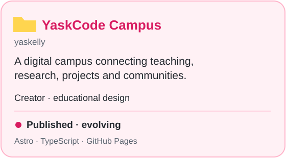</a>
  <a href="https://github.com/LUZ-Computing-Research/recursos-proyectos">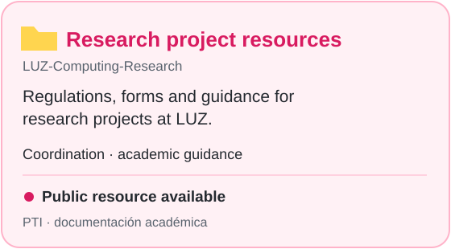</a>
  <a href="https://github.com/YaskCode/ing-sofware-y-base-datos/tree/main/docs/programa">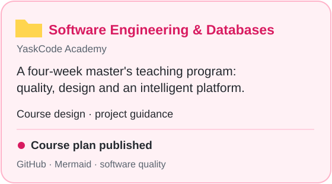</a>

  <a href="https://github.com/YaskCode/sistemas-inteligentes">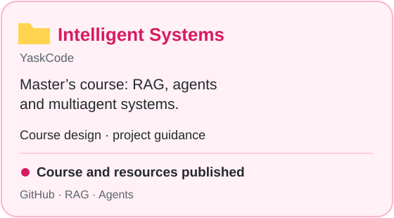</a>
  <a href="https://github.com/YaskCode-laboratory/wellness-platform-team1">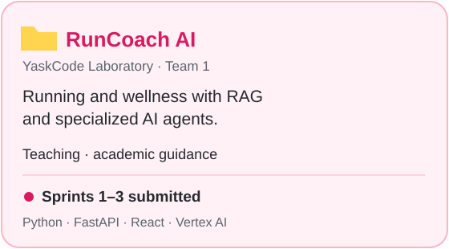</a>
  <a href="https://github.com/YaskCode-laboratory/wellness-platform-team6">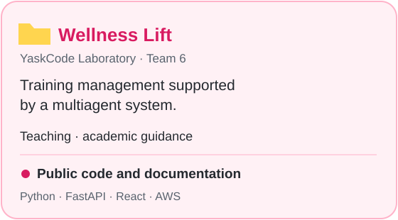</a>

Read project descriptions, my role and evidence

### YaskCode Campus
A digital campus inspired by university spaces, connecting education, research, projects and technology communities.
- **My role:** creator and educational experience designer.
- **Status:** published and evolving.
- **Technologies:** Astro, TypeScript, HTML, CSS and GitHub Pages.
- **Evidence:** [visit the Campus](https://yaskelly.github.io/) · [source code and documentation](https://github.com/yaskelly/yaskelly.github.io).

### Research Project Resources — LUZ
An institutional repository providing regulations, forms and guidance for research projects in the Computer Science Department.
- **My role:** academic coordination and student guidance as coordinator of Trabajo de Investigación (student research projects).
- **Status:** public resource available for consultation.
- **Evidence:** [repository and usage guide](https://github.com/LUZ-Computing-Research/recursos-proyectos).

### Software Engineering and Databases
A four-week teaching program covering quality, design and the development of an intelligent platform.
- **My role:** course design and supervision of master’s student projects.
- **Status:** course plan published; this resource alone does not represent a completed application.
- **Program tools:** GitHub, Mermaid, modeling and software quality assessment.
- **Evidence:** [weekly program](https://github.com/YaskCode/ing-sofware-y-base-datos/tree/main/docs/programa).

### Intelligent Systems
Master’s course: RAG, agents and multiagent systems.
- **My role:** course design · project guidance.
- **Status:** course and resources published.
- **Technologies and tools:** GitHub · RAG · Agents.
- **Evidence:** [code and documentation](https://github.com/YaskCode/sistemas-inteligentes).

### RunCoach AI
Running and wellness with RAG and specialized AI agents.
- **My role:** teaching · academic guidance; developed by the student team.
- **Status:** sprints 1–3 submitted.
- **Technologies and tools:** Python · FastAPI · React · Vertex AI.
- **Evidence:** [code and documentation](https://github.com/YaskCode-laboratory/wellness-platform-team1).

### Wellness Lift
Training management supported by a multiagent system.
- **My role:** teaching · academic guidance; developed by the student team.
- **Status:** public code and documentation.
- **Technologies and tools:** Python · FastAPI · React · AWS.
- **Evidence:** [code and documentation](https://github.com/YaskCode-laboratory/wellness-platform-team6).

<a href="https://github.com/search?q=user%3Ayaskelly%20org%3AYaskCode%20org%3AYaskCode-laboratory%20org%3ALUZ-Computing-Research%20is%3Apublic&amp;type=repositories">Explore more public repositories →</a>

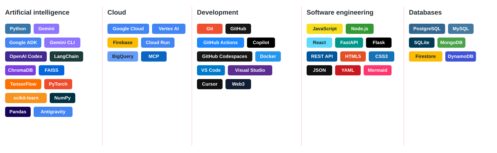

Technologies and documentation

- **Artificial intelligence:** [Python](https://docs.python.org/3/) · [Gemini](https://ai.google.dev/gemini-api/docs) · [Google ADK](https://google.github.io/adk-docs/) · [Gemini CLI](https://github.com/google-gemini/gemini-cli) · [OpenAI Codex](https://developers.openai.com/codex/) · [LangChain](https://docs.langchain.com/) · [ChromaDB](https://docs.trychroma.com/) · [FAISS](https://github.com/facebookresearch/faiss/wiki) · [TensorFlow](https://www.tensorflow.org/learn) · [PyTorch](https://docs.pytorch.org/) · [scikit-learn](https://scikit-learn.org/stable/) · [NumPy](https://numpy.org/doc/) · [Pandas](https://pandas.pydata.org/docs/) · [Antigravity](https://antigravity.google/docs).
- **Cloud:** [Google Cloud](https://cloud.google.com/docs) · [Vertex AI](https://cloud.google.com/vertex-ai/docs) · [Firebase](https://firebase.google.com/docs) · [Cloud Run](https://cloud.google.com/run/docs) · [BigQuery](https://cloud.google.com/bigquery/docs) · [MCP](https://modelcontextprotocol.io/docs/).
- **Development:** [Git](https://git-scm.com/doc) · [GitHub](https://docs.github.com/) · [GitHub Actions](https://docs.github.com/actions) · [Copilot](https://docs.github.com/copilot) · [GitHub Codespaces](https://docs.github.com/codespaces) · [Docker](https://docs.docker.com/) · [VS Code](https://code.visualstudio.com/docs) · [Visual Studio](https://learn.microsoft.com/visualstudio/) · [Cursor](https://cursor.com/docs) · [Web3](https://ethereum.org/developers/docs/).
- **Software engineering:** [JavaScript](https://developer.mozilla.org/docs/Web/JavaScript) · [Node.js](https://nodejs.org/docs/latest/api/) · [React](https://react.dev/learn) · [FastAPI](https://fastapi.tiangolo.com/) · [Flask](https://flask.palletsprojects.com/) · [REST API](https://learn.microsoft.com/azure/architecture/best-practices/api-design) · [HTML5](https://developer.mozilla.org/docs/Web/HTML) · [CSS3](https://developer.mozilla.org/docs/Web/CSS) · [JSON](https://www.json.org/) · [YAML](https://yaml.org/spec/) · [Mermaid](https://mermaid.js.org/intro/).
- **Databases:** [PostgreSQL](https://www.postgresql.org/docs/) · [MySQL](https://dev.mysql.com/doc/) · [SQLite](https://sqlite.org/docs.html) · [MongoDB](https://www.mongodb.com/docs/) · [Firestore](https://cloud.google.com/firestore/docs) · [DynamoDB](https://docs.aws.amazon.com/amazondynamodb/latest/developerguide/).

  
  
  

### 📈 Contribution Activity

About these statistics and updates

**Images generated from the GitHub API; these are not live counters.** Automatic updates are scheduled daily at 05:17 UTC (01:17 in Venezuela) and save the images to this review branch. A complete run was verified on October 10, 2026. Check the automation history for the latest run and any failures.

[View current GitHub activity](https://github.com/yaskelly) · [Automation history](https://github.com/yaskelly/yaskelly/actions)

Classes, talks and workshops on [YouTube — YaskCode](https://www.youtube.com/@yaskcode).

Selection retrieved from the channel's public feed. Videos are in Spanish; their original titles are preserved. Each video links to its original publication.

<!-- YOUTUBE:START -->

Video titles and dates

- <a href="https://www.youtube.com/watch?v=jihUXbHcd4c">Validación y Pruebas de Software | Unitarias, Integración, Caja Negra y Caja Blanca</a>
- <a href="https://www.youtube.com/watch?v=8mfNY1ljvGA">SI Erick</a>
- <a href="https://www.youtube.com/watch?v=hT-6WChdBHI">Interoperabilidad y communicación entre agentes inteligentes</a>

<!-- YOUTUBE:END -->

<a href="https://www.youtube.com/@yaskcode">View more on YouTube →</a>

## Contact and academic background

[Full academic background](https://yaskelly.github.io/yaskellyyedra/) · [LinkedIn](https://www.linkedin.com/in/yaskelly/) · [Academic contact: yyedra@fec.luz.edu.ve](mailto:yyedra@fec.luz.edu.ve)

> Learning software engineering by practicing software engineering.

