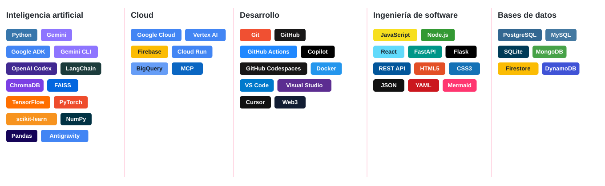

  

**Español** · [English](README.en.md)

# Hola, soy Yaskelly Yedra

**Profesora e investigadora en Computación · Universidad del Zulia (LUZ), Venezuela**

Conecto la ingeniería de software, la inteligencia artificial, la ciencia de datos y cloud con la enseñanza y la investigación. A través de YaskCode, diseño experiencias educativas en las que estudiantes aprenden construyendo proyectos, documentando decisiones y evaluando la calidad del proceso y del producto.

<table align="center">
  <tr>
    <th align="center" width="50%"><a href="https://yaskelly.github.io/yaskellyyedra/">Web académica personal</a></th>
    <th align="center" width="50%"><a href="https://yaskelly.github.io/">Campus YaskCode</a></th>
  </tr>
  <tr>
    <td align="center">Trayectoria, docencia, investigación y servicio académico.</td>
    <td align="center">Ecosistema de aprendizaje, proyectos y recursos abiertos.</td>
  </tr>
</table>

  
  
  
  
  
  
  

## Docencia, investigación y comunidad

- **Docencia:** enseño ingeniería de software, IA, ciencia de datos, bases de datos, arquitectura y cloud. [Explorar un programa docente](https://github.com/YaskCode/ing-sofware-y-base-datos/tree/main/docs/programa).
- **Investigación:** vinculo ingeniería de software y ecosistemas digitales de aprendizaje con el acompañamiento de trabajos académicos. [Publicaciones en Google Scholar](https://scholar.google.com/citations?user=zySpQB0AAAAJ&hl=es) · [ORCID](https://orcid.org/0009-0004-4290-120X).
- **Comunidad:** organizadora de GDG Caracas y embajadora Women Techmakers y WiDS. [Actividades de GDG Caracas](https://gdg.community.dev/gdg-caracas/) · [perfil WiDS](https://community.widsworldwide.org/members/41641225).

  
  
  
  
  
  

Leer el propósito de cada organización

- [**YaskCode Academy**](https://github.com/YaskCode): Formación y recursos para aprender construyendo.
- [**YaskCode Laboratory**](https://github.com/YaskCode-laboratory): Proyectos estudiantiles y buenas prácticas de ingeniería.
- [**YaskCode Research**](https://github.com/YaskCode-research): Investigación y acompañamiento académico.
- [**YaskCode Community**](https://github.com/YaskCode-community): Encuentros, colaboración y aprendizaje compartido.
- [**YaskCode Build**](https://github.com/YaskCode-build): Prototipos e innovación. En desarrollo.
- [**Smart Learning**](https://github.com/YaskCode-smart-learning): Ecosistemas de aprendizaje. Próximamente.

  
  
  

Leer sobre estos espacios

- [**LUZ Computing Research**](https://github.com/LUZ-Computing-Research): Recursos y coordinación institucional de investigación.
- [**Maestría TIC LUZ**](https://github.com/maestriaentic-luz): Formación, proyectos y acompañamiento de posgrado.
- [**GDG Caracas**](https://gdg.community.dev/gdg-caracas/): Comunidad de desarrolladores, charlas y talleres.

## Proyectos y recursos destacados

  
  
  

  
  
  

Leer descripciones, mi participación y evidencias

### Campus YaskCode
Un campus digital inspirado en espacios universitarios que conecta formación, investigación, proyectos y comunidades.
- **Mi participación:** creadora y responsable del diseño de la experiencia educativa.
- **Estado:** publicado, en evolución.
- **Tecnologías:** Astro, TypeScript, HTML, CSS y GitHub Pages.
- **Evidencias:** [visitar el Campus](https://yaskelly.github.io/) · [código y documentación](https://github.com/yaskelly/yaskelly.github.io).

### Recursos para Proyectos de Investigación — LUZ
Repositorio institucional que centraliza reglamentos, formatos y guías para los Proyectos de Investigación del Departamento de Computación.
- **Mi participación:** coordinación académica y orientación a estudiantes en mi rol de coordinadora de Trabajo de Investigación.
- **Estado:** recurso público disponible para consulta.
- **Evidencia:** [repositorio y guía de uso](https://github.com/LUZ-Computing-Research/recursos-proyectos).

### Ingeniería de Software y Bases de Datos
Programa docente organizado en cuatro semanas, con actividades de calidad, diseño y desarrollo de una plataforma inteligente.
- **Mi participación:** diseño docente y acompañamiento de proyectos de maestría.
- **Estado:** planificación del curso publicada; este recurso no representa por sí solo una aplicación terminada.
- **Herramientas del programa:** GitHub, Mermaid, modelado y evaluación de calidad de software.
- **Evidencia:** [programa semanal](https://github.com/YaskCode/ing-sofware-y-base-datos/tree/main/docs/programa).

### Sistemas Inteligentes
Programa de maestría: RAG, agentes y sistemas multiagente.
- **Mi participación:** diseño docente · acompañamiento.
- **Estado:** programa y recursos publicados.
- **Tecnologías y herramientas:** GitHub · RAG · Agentes.
- **Evidencia:** [código y documentación](https://github.com/YaskCode/sistemas-inteligentes).

### RunCoach AI → Intelligent Wellness Platform
Proyecto académico que evoluciona RunCoach AI, una aplicación de entrenamiento de running, hacia Intelligent Wellness Platform, integrando RAG y agentes de IA especializados.
- **Mi participación:** docencia · orientación académica; desarrollo realizado por el equipo estudiantil.
- **Estado:** sprints 1–3 entregados.
- **Tecnologías y herramientas:** Python · FastAPI · React · Vertex AI.
- **Evidencia:** [código y documentación](https://github.com/YaskCode-laboratory/wellness-platform-team1).

### Wellness Lift
Gestión de entrenamiento con asistencia de un sistema multiagente.
- **Mi participación:** docencia · orientación académica; desarrollo realizado por el equipo estudiantil.
- **Estado:** código y documentación públicos.
- **Tecnologías y herramientas:** Python · FastAPI · React · AWS.
- **Evidencia:** [código y documentación](https://github.com/YaskCode-laboratory/wellness-platform-team6).

<a href="https://github.com/search?q=user%3Ayaskelly%20org%3AYaskCode%20org%3AYaskCode-laboratory%20org%3ALUZ-Computing-Research%20is%3Apublic&amp;type=repositories">Ver más repositorios públicos →</a>

Tecnologías y documentación

- **Inteligencia artificial:** [Python](https://docs.python.org/3/) · [Gemini](https://ai.google.dev/gemini-api/docs) · [Google ADK](https://google.github.io/adk-docs/) · [Gemini CLI](https://github.com/google-gemini/gemini-cli) · [OpenAI Codex](https://developers.openai.com/codex/) · [LangChain](https://docs.langchain.com/) · [ChromaDB](https://docs.trychroma.com/) · [FAISS](https://github.com/facebookresearch/faiss/wiki) · [TensorFlow](https://www.tensorflow.org/learn) · [PyTorch](https://docs.pytorch.org/) · [scikit-learn](https://scikit-learn.org/stable/) · [NumPy](https://numpy.org/doc/) · [Pandas](https://pandas.pydata.org/docs/) · [Antigravity](https://antigravity.google/docs).
- **Cloud:** [Google Cloud](https://cloud.google.com/docs) · [Vertex AI](https://cloud.google.com/vertex-ai/docs) · [Firebase](https://firebase.google.com/docs) · [Cloud Run](https://cloud.google.com/run/docs) · [BigQuery](https://cloud.google.com/bigquery/docs) · [MCP](https://modelcontextprotocol.io/docs/).
- **Desarrollo:** [Git](https://git-scm.com/doc) · [GitHub](https://docs.github.com/) · [GitHub Actions](https://docs.github.com/actions) · [Copilot](https://docs.github.com/copilot) · [GitHub Codespaces](https://docs.github.com/codespaces) · [Docker](https://docs.docker.com/) · [VS Code](https://code.visualstudio.com/docs) · [Visual Studio](https://learn.microsoft.com/visualstudio/) · [Cursor](https://cursor.com/docs) · [Web3](https://ethereum.org/developers/docs/).
- **Ingeniería de software:** [JavaScript](https://developer.mozilla.org/docs/Web/JavaScript) · [Node.js](https://nodejs.org/docs/latest/api/) · [React](https://react.dev/learn) · [FastAPI](https://fastapi.tiangolo.com/) · [Flask](https://flask.palletsprojects.com/) · [REST API](https://learn.microsoft.com/azure/architecture/best-practices/api-design) · [HTML5](https://developer.mozilla.org/docs/Web/HTML) · [CSS3](https://developer.mozilla.org/docs/Web/CSS) · [JSON](https://www.json.org/) · [YAML](https://yaml.org/spec/) · [Mermaid](https://mermaid.js.org/intro/).
- **Bases de datos:** [PostgreSQL](https://www.postgresql.org/docs/) · [MySQL](https://dev.mysql.com/doc/) · [SQLite](https://sqlite.org/docs.html) · [MongoDB](https://www.mongodb.com/docs/) · [Firestore](https://cloud.google.com/firestore/docs) · [DynamoDB](https://docs.aws.amazon.com/amazondynamodb/latest/developerguide/).

  
  
  

### 📈 Actividad de contribuciones

Sobre estas estadísticas y sus actualizaciones

**Imágenes generadas a partir de la API de GitHub; no son contadores en tiempo real.** La actualización automática está programada diariamente a las 05:17 UTC (01:17 en Venezuela) y guarda las imágenes en la rama `main` del perfil publicado. La ejecución completa se verificó el 10 de octubre de 2026. Consulta el historial de automatizaciones para conocer la última ejecución y cualquier fallo.

[Consultar la actividad actual en GitHub](https://github.com/yaskelly) · [Historial de automatizaciones](https://github.com/yaskelly/yaskelly/actions)

Clases, charlas y talleres en [YouTube — YaskCode](https://www.youtube.com/@yaskcode).

Selección actualizada diariamente a las 11:17 UTC (07:17 en Venezuela), desde el feed público del canal o su página de videos cuando el feed no está disponible. Las fechas se muestran únicamente cuando las proporciona el feed. Cada video enlaza con su publicación original.

<!-- YOUTUBE:START -->

Títulos y fechas de los videos

- <a href="https://www.youtube.com/watch?v=jihUXbHcd4c">Validación y Pruebas de Software | Unitarias, Integración, Caja Negra y Caja Blanca</a>
- <a href="https://www.youtube.com/watch?v=8mfNY1ljvGA">SI Erick</a>
- <a href="https://www.youtube.com/watch?v=hT-6WChdBHI">Interoperabilidad y communicación entre agentes inteligentes</a>

<!-- YOUTUBE:END -->

<a href="https://www.youtube.com/@yaskcode">Ver más en YouTube →</a>

## Contacto y trayectoria

[Trayectoria académica completa](https://yaskelly.github.io/yaskellyyedra/) · [LinkedIn](https://www.linkedin.com/in/yaskelly/) · [Contacto académico: yyedra@fec.luz.edu.ve](mailto:yyedra@fec.luz.edu.ve)

> Aprender Ingeniería de Software haciendo Ingeniería de Software.

